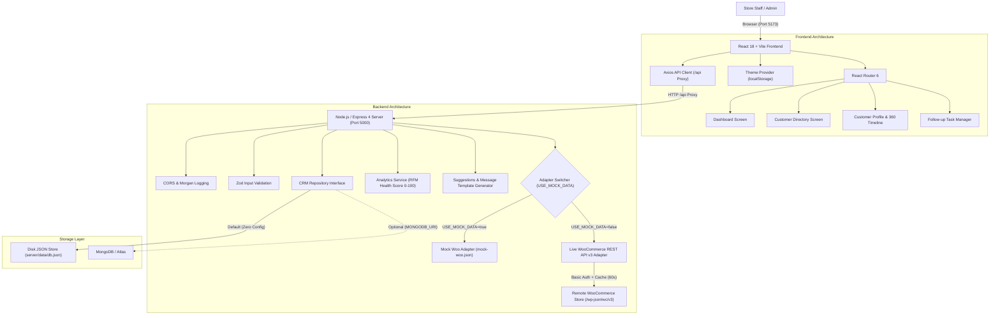

# SmartCRM - WooCommerce Customer Hub

An enterprise-grade, full-stack Customer Relationship Management (CRM) dashboard designed specifically for WooCommerce stores. SmartCRM unifies disparate WooCommerce order details, customer profiles, and follow-up lifecycles into a single, high-performing operational command center.

---

## 🚀 Quick Start (Exact Commands to Run)

### 1. Install all dependencies across root, server, and client:
```bash
npm run setup
```

### 2. Start both Server (Port 5000) and Client (Port 5173) concurrently:
```bash
npm run dev
```

### 3. Verification & Seeding Scripts:
```bash
# Generate 25 Indian customers, 90 orders over 6 months, and CRM showcase data:
npm run seed:mock

# Run automated smoke test suite across all 17 API endpoints:
npm run test:smoke

# Test connection to real WooCommerce REST API credentials:
npm run test:woo

# Seed a real WooCommerce store with 15 customers, 40 orders, and 5 products:
npm run seed:woo
```

---

## 🛠️ Tech Stack Table

| Technology | Version | Purpose |
| :--- | :--- | :--- |
| **React** | `18.3.1` | Modern component-based frontend framework with hooks and state management |
| **Vite** | `5.2.13` | Next-generation ultra-fast frontend build tool and hot module replacement dev server |
| **Tailwind CSS** | `3.4.4` | Utility-first styling configured with dark mode using the `'class'` strategy |
| **React Router** | `6.23.1` | Client-side declarative routing and URL parameter management |
| **Recharts** | `2.12.7` | Composable, responsive SVG charts (Revenue evolution bar chart, Status donut chart) |
| **Lucide React** | `0.395.0` | Minimalist, modern iconography matching the SaaS reference design |
| **React Hot Toast** | `2.4.1` | Lightweight, non-intrusive toast notifications for real-time user feedback |
| **Node.js** | `18+ / 22+` | Asynchronous JavaScript runtime environment |
| **Express** | `4.19.2` | Robust REST API server handling routing, middleware, and normalization |
| **Zod** | `3.23.8` | Strict runtime schema parsing and payload validation for API endpoints |
| **JSON-File Store** | Native | Synchronous zero-dependency persistence to `server/data/db.json` on disk |
| **Mongoose / MongoDB**| `8.4.1` (Opt)| Pluggable document database activated automatically when `MONGODB_URI` is provided |
| **WooCommerce REST API**| `v3` | REST API integration with Basic Auth, pagination, and guest order linking |
| **Concurrently** | `8.2.2` | Parallel development tooling to run Express and Vite simultaneously |

---

## 📐 Architecture Diagram



---

## 🔑 Environment Variables (`server/.env`)

| Variable | Default Value | Description |
| :--- | :--- | :--- |
| `PORT` | `5000` | Port for Express backend server |
| `USE_MOCK_DATA` | `true` | When `true`, serves simulated data; when `false`, makes real calls to WooCommerce |
| `WOOCOMMERCE_URL` | `https://your-store.example.com` | Base URL of your WordPress/WooCommerce site |
| `WOOCOMMERCE_CONSUMER_KEY` | `ck_...` | Read/Write WooCommerce REST API Consumer Key |
| `WOOCOMMERCE_CONSUMER_SECRET`| `cs_...` | Read/Write WooCommerce REST API Consumer Secret |
| `MONGODB_URI` | `""` | Optional MongoDB connection string |

---

## 📡 REST API Specification

| Method | Endpoint | Query / Body | Description |
| :--- | :--- | :--- | :--- |
| `GET` | `/api/health` | None | Returns server status, mode, and DB type |
| `GET` | `/api/health/woocommerce`| None | Checks live connection and returns store stats |
| `POST` | `/api/sync` | None | Forces refresh of WooCommerce cache |
| `GET` | `/api/dashboard/summary` | None | Returns KPIs, recent orders, charts, and follow-ups |
| `GET` | `/api/customers` | `?search=&segment=&sort=&page=&limit=` | Searchable, paginated customer directory |
| `GET` | `/api/customers/:id` | `:id` | Unified customer profile with 360 timeline & stats |
| `PATCH`| `/api/customers/:id` | `{ tags, owner, preferredContact }` | Updates customer CRM fields in real DB |
| `GET` | `/api/customers/:id/orders` | `:id` | Fetches all orders for customer (includes linked guest) |
| `GET` | `/api/customers/:id/interactions` | `:id` | Fetches customer notes and interaction logs |
| `POST` | `/api/customers/:id/interactions` | `{ type, summary, createdAt }` | Appends new interaction to timeline and DB |
| `GET` | `/api/followups` | `?status=all\|pending\|completed\|overdue` | Retrieves filtered list of follow-up tasks |
| `POST` | `/api/followups` | `{ customerId, title, dueDate, status }` | Creates a new follow-up task |
| `PATCH`| `/api/followups/:id` | `{ status: "completed"\|"pending" }` | 1-click status toggle; updates `completedAt` |
| `POST` | `/api/customers/:id/message`| `{ orderId }` | Generates personalized WhatsApp & Email messages |
| `GET` | `/api/export/customers.csv` | None | Generates real-time CSV download of customers |
| `GET` | `/api/export/followups.csv` | None | Generates real-time CSV download of follow-up tasks |

---

## 🎬 2-Minute Demo Script

> **Tech Stack Explanation Line:** *"SmartCRM is built on a modern decoupled architecture using React 18, Vite, and Tailwind CSS on the frontend, powered by an Express REST API with a pluggable repository layer that seamlessly switches between a local JSON-file store and live WooCommerce REST API v3 endpoints."*

1. **Dashboard Overview (0:00 - 0:30)**:
   - *"Welcome to SmartCRM! Notice our top badge showing current mode: 'Mock Mode (simulated integration)'. The top KPI cards show ₹3,63,350 in store revenue across 90 orders from 25 Indian customers."*
   - *"We can toggle dark mode instantly with the moon icon in the sidebar, which persists in localStorage."*
   - *"Notice our Revenue Evolution bar chart, Order Status donut chart, and the Urgent Follow-ups widget highlighting overdue actions in red."*
2. **Customer Directory & RFM Health Scoring (0:30 - 1:00)**:
   - *"Let's navigate to Customers. Notice the search bar is debounced for speed. We can filter by segments: VIP, Loyal, Active, New, At-Risk, or Churned."*
   - *"Every customer has an RFM health score from 0-100 calculated from recency, frequency, monetary value, and recent staff interactions."*
   - *"Let's open our showcase customer, Aarav Sharma."*
3. **Customer Profile, 360 Timeline & Smart Suggestions (1:00 - 1:40)**:
   - *"Aarav Sharma has a perfect Health Score of 100/100, 7 orders, and ₹46,400 in spend. Notice that guest orders placed with Aarav's verified billing email are automatically linked!"*
   - *"Look at the 'Suggested Next Actions' panel: the system detects high-value customers and prompts for VIP appreciation, or win-back for dormant users."*
   - *"Click 'Generate Message': notice how it creates a personalized WhatsApp and Email template pre-filled with Aarav's name, order CMD-5206, and amount, complete with a 1-click Copy button."*
   - *"Under Customer 360 Timeline, orders placed, notes logged, and follow-ups scheduled are unified in one chronological feed."*
4. **Follow-ups & CSV Export (1:40 - 2:00)**:
   - *"Under Follow-ups, staff can filter by Pending or Overdue tasks, complete items in a single click, or schedule new follow-ups with the customer picker."*
   - *"Both Customers and Follow-ups support 1-click real CSV exports."*
